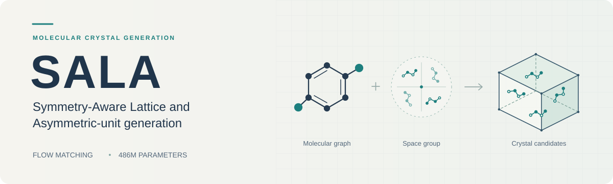

<p align="center">
  
</p>

<p align="center">
  <a href="https://www.python.org/"></a>
  <a href="https://pytorch.org/"></a>
  <a href="LICENSE"></a>
  <a href="https://huggingface.co/cWendi/SALA"></a>
</p>

<p align="center">
  <a href="https://wendi-cai.github.io/SALA/"><strong>Project website</strong></a> &nbsp;·&nbsp;
  <a href="https://arxiv.org/abs/2609.34690"><strong>Paper</strong></a> &nbsp;·&nbsp;
  <a href="https://huggingface.co/cWendi/SALA"><strong>Model weights</strong></a> &nbsp;·&nbsp;
  <a href="docs/inference.md"><strong>Inference guide</strong></a>
</p>

SALA generates molecular crystal structures from molecular graphs and a chosen space group. It jointly samples molecular conformations, crystal packing, and a symmetry-compatible lattice with a full-cell Crystal DiT flow-matching model.

This repository includes **data preprocessing and loading, training, fine-tuning, and inference**. The pretrained **486M-parameter EMA checkpoint** is hosted on Hugging Face. Training data are excluded because of licensing restrictions.

## From SMILES to crystal candidates

### 1. Install

Use Python 3.10 or later. For GPU inference, first install a PyTorch build compatible with your CUDA environment.

```bash
git clone https://github.com/WENDI-CAI/SALA.git
cd SALA
python -m venv .venv
source .venv/bin/activate
python -m pip install --upgrade pip
python -m pip install -e '.[inference]'
```

The `inference` extra installs RDKit for SMILES input and Hugging Face checkpoint downloads. Training and CIF/PT inference with a local checkpoint are available with `python -m pip install -e .`.

### 2. Generate

Generate four candidates for aspirin in space group **P1**:

```bash
sala-predict \
  --smiles 'CC(=O)Oc1ccccc1C(=O)O' \
  --space-group 1 \
  --num-samples 4 \
  --output outputs/aspirin \
  --device cuda
```

Use `--device cpu` to run on CPU. On first use, SALA downloads the approximately **1.95 GB** checkpoint to your local Hugging Face cache. No reference crystal is needed for SMILES input.

**The space group is a user-supplied condition.** P1 is a simple starting assumption, not a predicted or experimentally established space group for this example. Use a different `--space-group`, or an exact `--hall-number`, when appropriate. The released model generates heavy-atom structures in general positions. SMILES with explicit stereochemical annotations are rejected because the model does not encode those constraints.

### 3. Inspect the results

Open the generated CIF files in your preferred crystal viewer:

```text
outputs/aspirin/
├── generated/<target_id>/    # Candidate crystal structures (.cif)
├── generated_results.pt     # Coordinates, lattices, and metadata
├── input.json               # SMILES and target-construction settings
├── manifest.json            # Target identifiers and output paths
└── summary.json             # Run summary
```

Candidates are stochastic samples, without energy ranking or structural relaxation by default. Check molecular geometry, intermolecular contacts, and the properties relevant to your application before selecting a structure.

## Choose your input

| Input | Example | Details |
| :--- | :--- | :--- |
| SMILES | `sala-predict --smiles 'c1ccccc1' --space-group 14 --output outputs/benzene` | Molecular graph and specified symmetry; no reference structure required |
| CIF | `sala-predict --input /path/to/target.cif --output outputs/target` | Reads chemical connectivity and crystallographic conditions from a local CIF |
| SALA PT | `sala-predict --input /path/to/target.pt --output outputs/target` | Uses a prepared target record |
| Target collection | `sala-generate --help` | Folder and dataset-split generation with full sampling controls |

For salts and multicomponent systems, supply dot-separated SMILES. Use `--copies` to repeat the complete supplied composition in the asymmetric unit. [The inference guide](docs/inference.md) covers composition, symmetry settings, local checkpoints, offline operation, and batch generation.

## Train on your own data

Prepare licensed CIF files locally, then start training:

```bash
sala-preprocess \
  --root /absolute/path/to/licensed_cifs \
  --output /absolute/path/to/sala_data \
  --skip-bad --write-jsonl

sala-train \
  data.paths.pt_root=/absolute/path/to/sala_data \
  hydra.run.dir=outputs/train
```

The default configuration selects the full model on one CUDA GPU. Check preprocessing rejection reports and split counts before training. [Training and fine-tuning](docs/training.md) explains distributed training, memory controls, checkpoint initialization, and resuming a run. [Data preparation](docs/data.md) documents the input requirements and loader.

## Documentation

| Guide | Contents |
| :--- | :--- |
| [Inference](docs/inference.md) | SMILES, CIF/PT, symmetry, composition, cached weights, and outputs |
| [Training](docs/training.md) | From-scratch training, fine-tuning, resume, and multiple GPUs |
| [Data](docs/data.md) | CIF requirements, preprocessing, quality policies, and PT schema |
| [Model](docs/model.md) | Architecture, flow objective, checkpoint provenance, and limitations |

## Citation

If you use SALA in your research, please cite:

```bibtex
@misc{cai2026sala,
  title         = {Symmetry-Aware Flow Matching for End-to-end Molecular Crystal Generation},
  author        = {Wendi Cai and Fanyang Mo},
  year          = {2026},
  eprint        = {2609.34690},
  archivePrefix = {arXiv}
}
```

## License and data

The code is released under the [MIT License](LICENSE). Checkpoint terms are documented separately on the [Hugging Face model card](https://huggingface.co/cWendi/SALA). Input data remain subject to their own licenses.

No raw CIFs, processed training shards, dataset indices, or licensed sample structures are included in this repository or the model download. Data preparation, training, and inference run on your local inputs.
